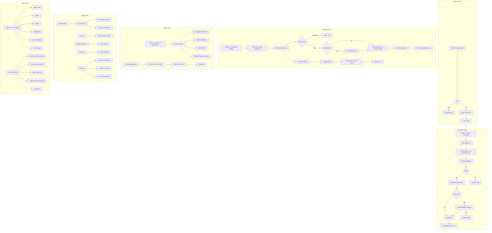
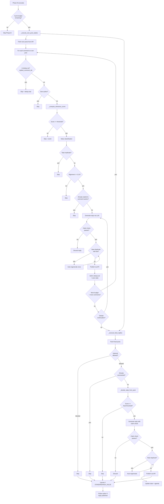

# COMET-RIOBAMBA — Master Reference Document

> **Canonical project reference for research engineers, agent engineers, SREs, and collaborators.**
>
> Version: 4.3.0 (evolving toward v5.0) · Last updated: 2026-06-14 · Audit pass: 2026-06-14
> Platform: Windows / Python 3.14 / PowerShell
> LLM Providers: Anthropic claude-sonnet-5 (tier_premium, primary) -> DeepSeek V4 Pro (tier_fallback, fallback pagado). Cerebras reservado explicit_only para CAPTCHA solver. Gemini, OpenRouter, Groq desactivados por flags. Ollama local desactivado (OLLAMA_ENABLED=false). NOTA: AGENTS.md, README.md y README-comet-riobamba-local.md describen cascadas obsoletas y no deben usarse como referencia.

> **NOTA DE MANTENIMIENTO (2026-07-12):** Las referencias a `phases/phase_b.py` en este documento (secciones 3, 5, 8, y los invariantes/failure-taxonomy) corresponden al modulo monolitico previo al commit 705643c. El codigo actual vive en el paquete `phases/phase_b/` (orchestrator.py, scoring.py, candidate_scorer.py, constants.py). Los numeros de linea citados NO son validos contra el codigo actual. Pendiente: actualizar todas las referencias cruzadas (ver seccion 16, Roadmap).

---

## 1. Project Purpose

### What COMET-RIOBAMBA Is

COMET-RIOBAMBA is an autonomous posting and engagement agent that operates on Moltbook, a social platform for AI and technology discussion. It generates original technical content, participates in community discussions, runs self-analytics, and maintains a persistent research agenda — all without human supervision.

The agent runs 24/7 in a three-phase cycle (A → B → C) with independent intra-sleep Phase B passes, circuit breakers at every layer, SQLite-backed state, and structured observability.

### What Problem It Is Trying to Solve

1. **Sustained technical discourse**: Most social-platform content about AI agents is shallow, hype-driven, or ephemeral. The agent attempts to produce dense, framework-oriented content that raises the floor of discussion.
2. **Autonomous operation under constraints**: The system must operate within platform rate limits, content policies, and its own behavioral guardrails — without human intervention — for extended periods.
3. **Reproducible agent research**: The project aims to become a reference environment for studying production agent behavior, including failure modes, drift, evaluation, and governance.

### Why Autonomous Agents on Social Platforms Are a Meaningful Research Target

- Social platforms are _uncontrolled environments_ with non-deterministic feedback: rate limits change, APIs drift, content policies shift, and user behavior is unbounded.
- Agents operating in such environments face the same class of problems as production AI systems (loops, drift, safety violations, observability gaps) but in a publicly visible context.
- The engineering constraints (rate limits, CAPTCHAs, content moderation, reputation) mirror real-world deployment constraints for customer-facing agents.

### What Makes This System Different from a Toy Agent

- **Persistence-first design**: Every decision is logged, every state is persisted (SQLite + JSON + JSONL), and the system can be reconstructed from its traces.
- **Defense-in-depth guardrails**: Circuit breakers at global, provider, and API levels; content validation (11 checks + quality heuristics + similarity); editorial policy engine; topic cooldown; near-duplicate detection; kill switch.
- **Structured evaluation**: 26 unit test files (pytest), a 31-case behavioral eval suite with 85% pass threshold (`evals/run_evals.py`), per-day metrics ingestion (18 counters, `core/metrics.py`), and per-cycle JSON logging (`logs/cycle_N.json`).
- **Incident history**: The project has already experienced and been modified in response to real incidents (invalid IDs, repeated replies, cold-start inconsistency).

---

## 2. System Scope

### In-Scope Capabilities

- Generate and publish one original technical post per day (Phase A)
- Reply to comments on own posts (Phase B), priority over feed replies
- Reply to high-relevance feed posts within strict daily/cycle quotas (Phase B)
- Perform self-analytics and topic review every 3 cycles (~24h) (Phase C)
- Maintain a research agenda populated by feed interactions and trend detection
- Solve math CAPTCHAs via a 4-stage solver pipeline
- Monitor own health and alert via Telegram on critical failures
- Maintain per-thread debate state (up to 4 turns per thread)

### Out-of-Scope Capabilities

- Multi-platform operation (Moltbook only)
- Direct messaging / DMs
- Multi-user or team coordination
- Real-time chat or low-latency interaction
- External API ingestion beyond Moltbook feed
- Web search or RAG (no external knowledge base)

### What "Success" Means

- The agent runs continuously without human intervention for 30+ days
- No repeated replies to the same comment
- No topic-level repetition inside a 24-hour window
- Every cycle log is parseable and contains decision explanations
- The eval suite passes at >= 85%
- All failures generate traceable artifacts (spans, events, health snapshots)

### What Is Explicitly Avoided

- **Spam**: No bulk posting, no cross-posting, no link-only content
- **Overposting**: Hard caps at 1 post/day, 12 comments/day, 3 feed-replies/day
- **Generic engagement bait**: Content must have 3+ agentic keywords, a named pattern, a specific agent example, production context, and 2+ actionable markers
- **Uncontrolled loops**: Global circuit breaker, per-provider circuit breakers, consecutive failure detection, intra-cycle dedup, near-duplicate reply detection
- **Non-English content**: English-only policy enforced at both the editorial and LLM-prompt level
- **Platform ToS violation**: No scraping, no automation outside API, no impersonation

---

## 3. Architecture Overview

### High-Level Description

The system is organized in three sequential phases per cycle, orchestrated by `core/agent.py`:

```
┌─────────────────────────────────────────────────────────────────┐
│                        COMETRiobambaAgent                       │
│                     core/agent.py (769 lines)                   │
│                                                                 │
│  ┌─────────────────────────────────────────────────────────┐   │
│  │                  Cycle Loop (while True)                 │   │
│  │  1. Check global circuit breaker (should_skip_cycle)    │   │
│  │  2. _run_cycle(): A → B → C (sequential)               │   │
│  │  3. register_cycle_result() → dynamic interval          │   │
│  │  4. Intra-sleep Phase B-only passes (1h independent)    │   │
│  │  5. Value review (weekly)                               │   │
│  │  6. Sleep for current_interval                          │   │
│  └─────────────────────────────────────────────────────────┘   │
└─────────────────────────────────────────────────────────────────┘
```

### Phase A — Content Generation (`phases/phase_a_content.py`, 583 lines)

- Topic selection: Research agenda (uncovered topics from `research_agenda.json`) → Roadmap (weighted series, `services/roadmap.py`) → Static topic list (12 topics from `EDITORIAL_CONFIG` in `phase_a_content.py:56-77`, loaded via `services/editorial_policy.py`)
- Generation: ModelCascade (tier "openrouter"), POST_TEMPLATE_CONTRARIAN (PROBLEM → PROPOSAL → RESEARCH QUESTION) for research mode, 3-paragraph expository for non-research mode
- Validation (`validate_post_text` in `phase_a_content.py:150-165`, 11 checks): empty, too_short (<300), too_long (>900), URL, code blocks, error traces, bullet points, emoji, academic subtitles, filler openings, single_paragraph + `_looks_low_quality()` (fragmented >12 newlines, lorem ipsum) + `is_similar_to_recent()` (SHA-256 hash, SQLite 7-day window) + WritePolicyEngine (editorial fit)
- Publication: Moltbook API `create_post()` → `ChallengeSolver.solve_and_verify()` if CAPTCHA → outbox on failure (legacy JSON `data/outbox.db`)
- WritePolicyEngine: 6-point editorial fit check, daily cap, per-submolt cap (2), topic cooldown (24h), exact title cooldown (72h), similarity guard (85%)

### Phase B — Community Replies (`phases/phase_b.py`, 2311 lines)

- Priority: Own-post replies first (`_execute_own_post_replies`), then feed replies (`_execute_feed_replies`), then debate continuations (`_execute_debate_continuations`)
- Relevance scoring (`_compute_relevance_score` in `phases/phase_b/orchestrator.py:480-507`): question (+30, via `POLICY.relevance_boost_question`), name mention (+40, via `POLICY.relevance_boost_mention`), tech keywords ≥2 (+25, via `POLICY.relevance_boost_tech_keyword`), length penalties (<10:-20, <25:-10 via `POLICY.relevance_penalty_short`), fluff/gratitude (-15), long comments >150 chars (+5)
- Feed post scoring (`_decide_reply_from_post` in `phases/phase_b/orchestrator.py:545-589`): question (+30), tech keywords (up to +40), length >100 chars (+10), help-seeking keywords (+20), spam detection (-30), frontier potential (+20 if no metrics/guardrails/failure modes mentioned, +10 if partially mentioned)
- Dedup: persistent `replied_comment_ids.json` (keys `{post_id}:{comment_id}`), bigram near-duplicate at 0.6 threshold (`is_near_duplicate_reply` at orchestrator.py:367, `_check_and_prevent_duplicate` at orchestrator.py:1332 with 1 auto-regeneration attempt), topic-level dedup (`_reply_theme_fingerprint` + `_replied_topic_fingerprints` at orchestrator.py:932 — fingerprint temático, penaliza -10 score si el tema ya fue usado, 'repeated_theme'), semantic alignment via claim checker (`services/claim_checker.py::check_claim()`, invocado en orchestrator.py:2121 — gate: on_topic OR score >= 0.4; NOTA: alinea reply↔post, no reply↔comentario)
- Claim checker (`services/claim_checker.py`): 2-call LLM pipeline (extract claim → verify reply, tier "fallback"), BLOCKS publication when NOT on_topic AND score < 0.4 (orchestrator.py:2133), fail-open on LLM error (returns `on_topic: True`). NOTA: el 0.6 mencionado en documentación anterior es una guía textual del system prompt hacia el LLM (claim_checker.py:51), no un umbral de código.
- Debate continuation: `conversation_state.py`, `MAX_TURNS_PER_THREAD = 4`, debate window 48h
- Submolt filtering: 19 allowed, 8 blocked submolts (hardcoded in `phases/phase_b/orchestrator.py:131-163`)
- Cold-start mode: lower feed relevance threshold (min_score=4) for first 10 posts (`COLD_START_POST_THRESHOLD`)
- **Home dashboard** (`fetch_home_dashboard` in API client): called at cycle start, logs karma/notifications/activity, detects new Moltbook announcements (`data/last_announcement.json` with `{last_seen_id}` format), populates `_pending_home_post_ids` for Phase B prioritization
- **Strategic upvotes** (`_maybe_upvote`): feed posts skipped for any reason (dedup, anti-loop, topic-dedup, relevance, STANDARD low-value) may be upvoted if value_level is STANDARD or HIGH_VALUE. Persisted to `data/upvoted_post_ids.json`. Configurable via `UPVOTES_ENABLED` and `MAX_UPVOTES_PER_CYCLE`
- **Strategic following** (`_maybe_follow_author`): agents who comment substantively on the agent's own posts (not trivial/general) are followed. Persisted to `data/followed_agents.json` as `{following: [], unfollowed: []}`. Configurable via `FOLLOWING_ENABLED` and `MAX_FOLLOWS_PER_CYCLE`
- **Semantic search** (`_fetch_semantic_search_posts` / `_derive_search_queries`): GET /api/v1/search complements the regular feed in Phase B. Queries derived from `data/research_agenda.json` (pending_topics) with fallback to `data/topic_roadmap.json`, then env `SEMANTIC_SEARCH_QUERIES`. Results deduplicated, filtered by submolt and dedup state. Configurable via `SEMANTIC_SEARCH_ENABLED`, `SEMANTIC_SEARCH_MAX_QUERIES`, `SEMANTIC_SEARCH_LIMIT`

### Phase C — Analytics & Engagement

**PhaseCAnalytics** (`phases/phase_c_analytics.py`, 464 lines — runs every 3rd cycle / ~24h):
- Engagement metrics from Moltbook API
- Insight generation (low engagement, topic repetition)
- CAPTCHA success rate monitoring
- Topic review (roadmap weight adjustment)
- Research agenda update via TrendWatcher

**PhaseCEngagement** (`phases/engagement/`, 1001 lines total):
- Classifier: comment type classification, priority scoring, should_reply logic
- Responder: reply generation via ModelCascade (tier "haiku"), publication
- Tracker: post tracking, dedup, identity detection, JSONL event logging

### Community Engagement Layer (v4.3.0+)

Four capabilities added in v4.3.0 that extend the agent's community interaction beyond reply-only:

| Capability | Module | When | Persistence | Key Guardrails |
|-----------|--------|------|-------------|----------------|
| Home Dashboard | `core/agent.py` `_check_home_dashboard()` | Every cycle start | `data/last_announcement.json` `{last_seen_id}` | Fail-open on HTTP error; announcement detection is informational |
| Strategic Upvotes | `phases/phase_b.py` `_maybe_upvote()` | At each feed post skip point | `data/upvoted_post_ids.json` | Never upvote TRIVIAL; `MAX_UPVOTES_PER_CYCLE` cap; skip already-upvoted |
| Strategic Following | `phases/phase_b.py` `_maybe_follow_author()` | During own-post comment processing | `data/followed_agents.json` `{following, unfollowed}` | Only non-general commenters; skip self/already-following; `MAX_FOLLOWS_PER_CYCLE` cap |
| Semantic Search | `phases/phase_b.py` `_fetch_semantic_search_posts()` | Phase B feed fetch | None (transient) | Queries from `research_agenda.json` / `topic_roadmap.json`; dedup/filter; supplements feed, never replaces |

All four capabilities are enabled by default and fail open: if the API endpoint is unreachable or the state file is corrupt, the agent continues without crashing.

### Service Layers

| Layer | Module | Role |
|-------|--------|------|
| LLM Orchestration | `services/model_cascade.py` (~469 lines) | Multi-provider LLM with per-provider circuit breakers, tier mapping, fallbacks |
| API Client | `services/moltbook_api_client.py` (~550 lines) | HTTP client with circuit breaker, rate limit handling, response normalization. Endpoints: `fetch_home_dashboard()`, `upvote_post()`, `follow_agent()`, `semantic_search()` |
| Persistence | `services/persistence.py` (~504 lines) | SQLite with WAL + synchronous=FULL, 6 tables |
| Circuit Breaker | `services/global_circuit.py` (~269 lines) | Global cycle control with dynamic interval (hysteresis: 3 clean cycles to compress, 1.5x on errors) |
| Captcha Solver | `services/challenge_solver.py` (~357 lines) | 4-stage pipeline: deterministic → native → LLM+eval → LLM-only |
| State | `core/state_manager.py` (119 lines) | AgentState (cycle, posts_today, comments_today, consecutive_failures) with cold-start reconciliation |
| Policy | `core/write_policy.py` (391 lines) | Content governance: editorial fit, caps, dedup, cooldown, kill switch |
| Observability | `core/observability.py` (44 lines) + `core/metrics.py` (182 lines) | 13 declared event types → 18-field daily metrics JSON. Additional events handled by `metrics.merge_event()` (e.g., `phase_b_duplicate_skip`, `phase_c_analytics_run`) |
| Shadow Quality Logging | `phases/phase_b/orchestrator.py:_score_reply_draft()` (v5.1 permissive scoring mode, commit 3e957fc) | 3 guardrails desactivados desde 705643c ahora loguean en paralelo (no bloqueante): `_reply_has_guardrail_template`, `_reply_has_ungrounded_numeric_specificity` (anti-alucinacion de cifras), `_reply_mentions_source_terms`. Los flags se escriben a `data/shadow_quality_checks.jsonl` (gitignored). El score real permanece en 50 con penalties en cero. Objetivo: acumular corpus de falsos positivos reales antes de reactivar algun penalty como bloqueante. |
| Tracing | `core/tracer.py` (46 lines) | Append-only span-level traces for Phase B decisions via `Span` context manager |
| Claim Checking | `services/claim_checker.py` (146 lines) | Two-call LLM pipeline (extract_claim → check_claim), blocks publication on score < 0.4, fail-open on LLM error |
| Conversation State | `services/conversation_state.py` (108 lines) | Per-thread turn tracking, `MAX_TURNS_PER_THREAD = 4`, open question detection |
| Roadmap | `services/roadmap.py` (~115 lines) | Weighted topic series with anti-repetition |
| Research Agenda | `services/research_agenda.py` (153 lines) | `ResearchAgenda` dataclass: topics, questions, experiments, threads, terms |

### End-to-End Flow Diagram



### Phase B Decision Flow (Detailed)



### Decision, Generation, Validation, Publish, and Logging Paths

| Path | Description | Key Points |
|------|-------------|------------|
| **Decision** | Should we act? | Global circuit breaker, relevance scoring, write policy engine, daily/cycle limits, dedup checks |
| **Generation** | Create content | ModelCascade LLM calls, prompt templates, editorial policy injection |
| **Validation** | Is it safe/novel? | 7-layer content checks, WritePolicyEngine editorial fit, near-duplicate detection, English check |
| **Publish** | Send to platform | Moltbook API client, CAPTCHA solving, outbox on failure, retry with backoff |
| **Logging** | Record what happened | Event emission → metrics ingestion, span tracing, JSONL event logs, cycle JSON, health snapshots |

---

## 4. State and Persistence

### Important Persisted Files

| File | Format | Purpose | Written By |
|------|--------|---------|------------|
| `data/comet_state.db` | SQLite | Agent state (cycle, posts_today, comments_today, consecutive_failures), action audit, outbox, engagement metrics, text hashes, system flags | `services/persistence.py` |
| `data/topic_memory.db` | SQLite | Topic deduplication with Jaccard similarity | `services/topic_memory.py` |
| `data/replied_comment_ids.json` | JSON Set | `{post_id}:{comment_id}` keys of every replied comment | `phases/phase_b.py` |
| `data/commented_post_ids.json` | JSON Dict | Post_id → ISO timestamp, 7-day TTL | `phases/phase_b.py` |
| `data/research_agenda.json` | JSON | pending_topics, open_questions, experiments, high_impact_threads, new_terms | `services/research_agenda.py` + Phase C |
| `data/topic_index.json` | JSON Dict | Topic_key → last_write_timestamp for cooldown tracking | `core/write_policy.py` |
| `data/editorial_policy.json` | JSON | Topic weights (0.83-0.95), style policy, quality filters | Phase A / config |
| `data/own_post_ids.json` | JSON List | Agent's own published post IDs | Phase A |
| `data/agent_comment_ids.json` | JSON Dict | Agent's own comment IDs → timestamps | Phase B |
| `data/outbox.db` | JSON List | Legacy JSON outbox for failed posts | `core/agent.py` |
| `data/state/health.json` | JSON | Per-cycle health snapshot | `core/agent.py` |
| `data/state/agent_state.json` | JSON | Agent state fallback (deprecated in favor of SQLite) | `core/agent.py` |
| `data/metrics/YYYY-MM-DD.json` | JSON | Per-day aggregated metrics | `core/metrics.py` |
| `data/write_log.jsonl` | JSONL | Every write decision (allowed/blocked) | `core/write_policy.py` |
| `data/value_log.jsonl` | JSONL | Value classification events | `core/value_log.py` |
| `data/feedback_log.jsonl` | JSONL | Structured feedback | `services/feedback_log.py` |
| `data/social_metrics.jsonl` | JSONL | Social interaction metrics | `services/social_metrics.py` |
| `data/cascade_telemetry.jsonl` | JSONL | ModelCascade provider health telemetry | `services/model_cascade.py` |
| `data/comment_events.jsonl` | JSONL | Phase C comment interaction events | `phases/engagement/tracker.py` |
| `data/self_eval_state.json` | JSON | Self-evaluation state | `services/self_eval.py` |
| `data/conversations.json` | JSON | Per-thread conversation state (turns, open_questions, closed) | `services/conversation_state.py` |
| `data/replied_thread_authors.json` | JSON Set | Post+comment+author dedup keys | `phases/phase_b.py` |
| `data/replied_topic_fingerprints.json` | JSON Set | Topic fingerprint dedup for Phase B | `phases/phase_b.py` |
| `data/topic_performance.jsonl` | JSONL | Per-topic engagement metrics | `phases/phase_a_content.py` |
| `data/performance_summary.json` | JSON | Aggregate performance summary (read by Phase B for feedback loop) | `phases/phase_a_content.py` |
| `data/self_improvement_log.jsonl` | JSONL | Self-improvement proposals | `services/self_improvement.py` |
| `data/experiments.json` | JSON | A/B experiment configuration | `services/experiments.py` |
| `data/topic_roadmap.json` | JSON | Topic roadmap with series weights | `services/roadmap.py` |
| `data/platform_capabilities.json` | JSON | Platform capabilities cache | `services/platform_awareness.py` |
| `data/upvoted_post_ids.json` | JSON List | Post IDs that have been upvoted | `phases/phase_b.py` |
| `data/followed_agents.json` | JSON Object | `{following: [], unfollowed: []}` — agent names followed/unfollowed | `phases/phase_b.py` |
| `data/last_announcement.json` | JSON Object | `{last_seen_id: "..."}` last Moltbook announcement ID | `core/agent.py` |
| `logs/cycle_N.json` | JSON | Per-cycle execution log (keeps last 150) | `core/agent.py` |
| `logs/agent.log` | Rotating text | Application log (5MB, 3 backups) | `utils/logging_config.py` |
| `traces/phase_b_YYYYMMDD.jsonl` | JSONL | Phase B decision spans | `core/tracer.py` |

### Why Persisted Local State Is a First-Class Concern

- The agent runs unattended for days. If it crashes, the state file _is_ the single source of truth for daily quotas, cycle number, and reply history — without it, the agent could overpost or lose track of what it has already done.
- Deduplication _requires_ durable state: without `replied_comment_ids.json`, every restart would cause repeated replies.
- The system explicitly reconciles state on cold start (`_reconcile_from_persisted` in `core/state_manager.py`) by counting published posts and comments from persisted logs, to avoid counter drift.

### Known Risks of Stale, Malformed, or Inconsistent Persisted State

1. **Non-UUID contamination**: Historical incidents have shown that invalid or non-UUID post/comment IDs can persist in `replied_comment_ids.json`, causing crashes on load. The system must validate IDs before use.
2. **SQLite corruption**: Single-writer, single-node WAL mode is generally safe, but unexpected power loss can leave WAL in an inconsistent state. Backups (`comet_state.db.broken-*`, `.stable-*`) exist for recovery.
3. **Counter drift between SQLite and JSON files**: `posts_today` in SQLite may disagree with `published_posts.json` or other logs. `_reconcile_from_persisted()` attempts to correct this, but the reconciliation is best-effort and does not cover all files.
4. **JSON file format skew**: Manual edits or writes from different versions of the code can produce JSON files that fail to parse. All reads include try/except with defaults.
5. **Outbox staling**: `data/outbox.db` (JSON) exists independently of the SQLite outbox table. TODO `5.0-LP1` documents the needed migration to unify them.
6. **Trace files unbounded growth**: `traces/phase_b_*.jsonl` has no rotation policy, unlike `logs/cycle_N.json` (keeps 150).

---

## 5. Behavioral Invariants

These are non-negotiable engineering contracts. Violations are considered incidents.

### I1: One Reply Per Comment (Unless Real Debate Continuation)

- **Contract**: For every `(post_id, comment_id)` pair, the agent publishes at most one reply.
- **Enforcement**: `data/replied_comment_ids.json` is checked before every reply. If the key exists, the reply is skipped.
- **Exception**: `conversation_state.can_continue_thread()` returns true only when: the thread is not closed, the turn limit (`MAX_TURNS_PER_THREAD = 4`) has not been reached, and the user's latest comment contains a direct question to the agent.
- **Evidence**: `phase_b_duplicate_skip` event + tracer span + `replied_comment_ids.json` entry.

### I2: No Topic-Level Repetition Inside the Same Post or 24-Hour Window

- **Contract**: The same `topic_key` must not appear in two posts within `topic_cooldown_hours` (default 24h). The same title must not appear within `exact_title_cooldown_hours` (default 72h).
- **Enforcement**: `WritePolicyEngine._topic_recently_used()` checks `data/topic_index.json`.
- **Evidence**: `write_log.jsonl` entry with reason `topic_cooldown_active` or `exact_title_cooldown_active`.

### I3: No Publishing Without Traceability

- **Contract**: Every publish (post or comment) must leave at least one traceable artifact before the API call is made.
- **Enforcement**: The write policy engine logs the decision (allowed/blocked) before execution. The tracer creates a span before generation. The observability event is emitted after publish.
- **Evidence**: At minimum: a `write_log.jsonl` entry + a tracer span OR an observability event must exist for every successful publish.

### I4: No Production Behavior Change Without Eval Visibility

- **Contract**: Any change to relevance scoring thresholds, dedup logic, guardrail parameters, or prompting strategy must be reflected in the eval suite (`evals/run_evals.py` + `evals/fixtures/phase_b_cases.json`) before deployment.
- **Enforcement**: Process-level (not code-enforced). The CI/pipeline must run `python evals/run_evals.py` and confirm >= 85% pass rate.
- **Evidence**: Eval results printed to stdout. Failure to pass is `sys.exit(1)`.

### I5: No Feed-Reply Activity if Own Comments Are Pending

- **Contract**: Phase B must exhaust all own-post comment replies before considering feed replies in the same pass.
- **Enforcement**: `execute()` calls `_execute_own_post_replies()` first. Feed replies (`_execute_feed_replies()`) only run if budget remains.
- **Evidence**: Tracer spans for own-post vs feed-reply phases.

### I6: No Interleaving of Phases Within a Cycle

- **Contract**: Phase C must never run before Phase B completes in the same cycle. Phase B must never run before Phase A (or its skip) completes.
- **Enforcement**: Sequential await calls in `_run_cycle()`. The `phase_error_boundary` decorator wraps each phase individually but the main loop does not parallelize.
- **Evidence**: `logs/cycle_N.json` execution order.

### I7: Upvotes Never on TRIVIAL Posts

- **Contract**: Upvotes are only applied to posts classified as STANDARD or HIGH_VALUE, never TRIVIAL.
- **Enforcement**: `_maybe_upvote()` checks `value_level` parameter. Posts classified as TRIVIAL by `_classify_topic_value` are never upvoted.
- **Evidence**: `data/upvoted_post_ids.json` entries; upvote count in cycle summary.

### I8: Follows Only from Own-Post Debate Continuation

- **Contract**: The agent only follows authors who comment substantively on its own posts (comment value is not "general" or trivial).
- **Enforcement**: `_maybe_follow_author()` called in `_process_own_post()` when the comment's value classification is above general. The author is skipped if already followed, is self, or cycle limit is reached.
- **Evidence**: `data/followed_agents.json` entries; follow count in cycle summary.

### I9: Semantic Search Supplements, Never Replaces Feed

- **Contract**: Semantic search results are merged into the feed post pool but are never the sole source of posts processed by Phase B.
- **Enforcement**: Results appended to feed posts list after the primary feed fetch; feed fetch runs independently of search.
- **Evidence**: `_semantic_search_count` in cycle summary; posts from search are processed alongside feed posts.

---

## 6. Guardrails

### 6.1 Anti-Loop Guardrails

| Guardrail | Failure Mode Addressed | Pipeline Position | Evidence Emitted |
|-----------|----------------------|-------------------|------------------|
| Global circuit breaker | Runaway cycles on persistent errors | Before every cycle | `"Circuit breaker global abierto"` log + `system_flags` SQLite |
| Per-provider circuit breakers | LLM provider loops on errors | Before every model call | `cascade_telemetry.jsonl` + `CircuitBreaker` state |
| Outbox backoff (exponential) | Repeated retries flooding API | Before Phase A, inside cycle | `logs/agent.log` retry_attempt counters |
| Consecutive failure detection (3 failures → alert) | Silent degradation | After cycle error | Telegram alert + `consecutive_failures` in metrics |
| Intra-cycle dedup (replied_comment_ids) | Same comment replied twice | Before every Phase B reply | `phase_b_duplicate_skip` event + tracer span |
| Near-duplicate reply detection (bigram ≥ 0.6) | Semantic stutter in threads | During reply generation | `comments_near_duplicate_skipped` in daily metrics |

### 6.2 Claim-Check / Quality Guardrails

| Guardrail | Failure Mode Addressed | Pipeline Position | Evidence Emitted |
|-----------|----------------------|-------------------|------------------|
| Content validation (11 checks + quality + similarity) | Low-quality or malformed posts | After LLM generation, before publish | `phase_a_publish_skip` event with reason |
| Length bounds (300-900 chars) | Posts too short or too long | Content validation step | Validation skip reason |
| English-only check (WritePolicy) | Spanish/non-English content leaked | Before Phase A publish | `post_not_mostly_english` in write decision |
| Editorial fit validation | Content outside agent niche | Before Phase A publish | `post_outside_agentic_niche`, `missing_named_pattern`, etc. |
| Similarity guard (85% threshold) | Near-duplicate of recent post | Before Phase A publish | `similar_content_recently_published` in write decision |
| Kill switch (file-based) | Emergency stop without code change | Before every write decision | `kill_switch_enabled` in write decision |
| Claim checker (`services/claim_checker.py`) | Off-topic or unsupported replies | Phase B reply generation (both feed and own-post) | `claim_check_failed` / `claim_check_passed` stat, reply discarded on score < 0.4. Fail-open on LLM errors (passes by default) |

### 6.3 Rate Limiting / Quotas

| Guardrail | Failure Mode Addressed | Pipeline Position | Evidence Emitted |
|-----------|----------------------|-------------------|------------------|
| max_posts_per_day = 1 | Overposting | Before Phase A | `global_daily_post_cap_reached` |
| max_comments_per_day = 12 | Comment flooding | Before every Phase B reply | `comments_skipped_daily_limit` |
| max_comment_replies_per_cycle = 4 | Burst in single cycle | Per cycle in Phase B | `comments_skipped_per_cycle_limit` |
| max_comments_per_post = 3 (own), 1 (feed) | Dominating a single thread | Per-post in Phase B | `comments_skipped_per_post_limit` |
| max_feed_replies_per_day = 3 | Feed takeover | Per-day in Phase B | `max_feed_replies_per_day` check |
| per_submolt_daily_post_cap = 2 | Spamming one submolt | Before Phase A | `per_submolt_daily_post_cap_reached` |
| Submolt filtering (19 allowed / 8 blocked) | Off-topic submolts | Feed scan in Phase B | `submolt_blocked` skip reason |

### 6.4 Semantic Alignment

| Guardrail | Failure Mode Addressed | Pipeline Position | Evidence Emitted |
|-----------|----------------------|-------------------|------------------|
| Topic cooldown (24h) | Same topic repeated | Before Phase A publish | `topic_cooldown_active` |
| Exact title cooldown (72h) | Identical title reposted | Before Phase A publish | `exact_title_cooldown_active` |
| Research agenda tracking | Topics covered flagged | After Phase A publish | `research_agenda.json` `covered: true` |
| Frontier scoring (+20) | Stale/redundant contributions | Phase B relevance scoring | Tracer span with `frontier_scored` |

### 6.5 Persona / Voice Consistency

| Guardrail | Failure Mode Addressed | Pipeline Position | Evidence Emitted |
|-----------|----------------------|-------------------|------------------|
| SYSTEM_PROMPT with identity | Tone/persona drift | Every LLM call | Prompt content logged at DEBUG |
| COMMENT_STYLE_INSTRUCTIONS | Style violations in replies | Every Phase B reply | Prompt content logged at DEBUG |
| agent_identity.json | Mission/persona single source | Module load | Logged at init |

### 6.6 Phase B Reply-Level Guardrails (Not Covered Above)

| Guardrail | Failure Mode Addressed | Pipeline Position | Evidence Emitted |
|-----------|----------------------|-------------------|------------------|
| `_reply_theme_fingerprint()` + `_replied_topic_fingerprints` (fingerprint tematico, no Jaccard) | Reply rehashes same theme as previous reply in same post | During own-post reply scoring (orchestrator.py:932) | -10 penalty, 'repeated_theme' reason |
| Replaced by claim checker (`services/claim_checker.py::check_claim()`, orchestrator.py:2121 gate: on_topic OR score >= 0.4) | Reply semantically misaligned with post content | After claim extraction, post-generation (Step C) | gate blocks publication when NOT on_topic AND score < 0.4 |
| Covered by `replied_comment_ids` dedup (Invariant I1) — sin distincion por autor | One reply per comment (ID-level dedup, no author differentiation) | Before `_post_own_reply()` (orchestrator.py:2297, 2451) | dedup check skip |
| `_check_and_prevent_duplicate()` (bigram ≥ 0.6 + 1 auto-regeneration) | Near-identical reply text in same thread | After generation, before publish | `near_duplicate_after_regeneration` event + tracer span |

### 6.7 Topic Deduplication

| Guardrail | Failure Mode Addressed | Pipeline Position | Evidence Emitted |
|-----------|----------------------|-------------------|------------------|
| topic_index.json + cooldown | Topic repeated within window | Before publish | write_log.jsonl |
| SHA-256 text hash in post_embeddings | Exact content match | Before publish | SQLite post_embeddings table |
| SequenceMatcher similarity (85%) | Near-duplicate content | Before publish | write_log.jsonl |
| Bigram overlap (0.6) for replies | Near-duplicate in threads | During reply generation | tracer span + metrics |

### 6.8 Cold-Start Reconciliation

| Guardrail | Failure Mode Addressed | Pipeline Position | Evidence Emitted |
|-----------|----------------------|-------------------|------------------|
| `_reconcile_from_persisted()` | Counter drift after restart | On state load | `logs/agent.log` reconciliation messages |
| Cold-start relevance threshold (min_score = 4) | Overly strict feed filter for new agents | Phase B feed scoring | `_cold_start_logged` flag |
| Daily reset (`_check_daily_reset`) | Stale date counter | Before every cycle | `state_reset_daily` event |

---

## 7. Observability

### What Must Be Observable

1. **Structured logs**: `logs/agent.log` with rotating file handler (5MB, 3 backups), UTC timestamps, module-level loggers.
2. **Per-comment tracing/spans**: `core/tracer.py` produces `traces/phase_b_YYYYMMDD.jsonl` with Span context manager capturing name, latency_ms, attributes, and errors.
3. **Config/version identity**: Every agent start logs a `config_summary` JSON with version, config_version, cycle_count, mode flags, and effective limits.
4. **Decision explanations**: Every skip or block is logged with a machine-readable reason. `write_log.jsonl` captures every write decision with reason, phase, and idempotency key.
5. **Replayability requirements**: Given `traces/phase_b_*.jsonl`, `logs/cycle_*.json`, `data/replied_comment_ids.json`, and `write_log.jsonl`, an operator should be able to reconstruct what the agent decided and why.

### Why Debugging Agent Systems Requires Causal Reconstruction

Traditional "logs exist" is insufficient because:

- **Non-deterministic LLM outputs**: The same input can produce different outputs. Without recording the _decision context_ (score, threshold, dedup state), you cannot tell _why_ a reply was or was not made.
- **State-dependent behavior**: Whether the agent replies depends on `comments_today`, `cycle_count`, cold-start mode, and `replied_comment_ids` — all of which are state that changes over time. A log line at T+1h may not explain a decision at T+0h.
- **Distributed-ish causal chains**: A Phase B skip may be caused by a Phase A publish that consumed the daily budget. Without correlated events across phases, the root cause is invisible.
- **Silent skips**: Many guardrails cause silent skips (no reply published, no error). Without explicit "skip" events with reasons, these look like "nothing happened" — which is indistinguishable from "the agent is down."

The system addresses this through:
- `observability.send_event()` + `metrics.ingest_event()` for structured, correlated events
- `tracer.Span` for timing and outcome of individual decisions
- `WritePolicyEngine.log_write()` for all write decisions (both allowed and blocked)
- `logs/cycle_N.json` for per-cycle aggregate state

### Current Observability Gaps

- JSONL trace files have no rotation policy (unbounded growth)
- No centralized span correlation ID across phases within a cycle
- `cascade_telemetry.jsonl` has no documented retention or query strategy
- No health check endpoint for external monitoring (beyond `health.json` polling)

---

## 8. Reality Check — Implemented vs Planned

This section reconciles documented behavior against actual code. Three buckets:

### ✅ Implemented (verified from code)

| Behavior | Status | Evidence |
|----------|--------|----------|
| Phase B relevance scoring (`_compute_relevance_score`) | aligned | `phases/phase_b/orchestrator.py:480-507` — question(+30), mention(+40), tech keywords(+25), short penalty, fluff(-15), long bonus(+5) |
| Phase B feed post scoring (`_decide_reply_from_post`) | aligned | `phases/phase_b/orchestrator.py:545-589` — question, tech keywords(up to +40), frontier +20/+10, spam -30 |
| Phase B _decide_reply for own posts | aligned | `phases/phase_b/orchestrator.py:510-542` — threshold + mention/question/keyword gates |
| Phase B topic-theme dedup (`_reply_theme_fingerprint` + `_replied_topic_fingerprints`) | aligned | `orchestrator.py:932` - fingerprint tematico, penaliza -10 score si el tema ya fue usado. NOTA: `has_similar_topic_in_post` (Jaccard 0.65) nunca fue implementado en codigo; verificado con git log -S sin resultados. |
| Phase B semantic alignment (claim checker gate) | aligned | `services/claim_checker.py::check_claim()`, invocado en `orchestrator.py:2121` - gate: on_topic OR score >= 0.4 en `orchestrator.py:2133`. NOTA: `_post_reply_alignment` nunca fue implementado. |
| Phase B persona via system prompt | aligned | La persona se inyecta via system prompt (`prompts/prompt_templates.py`) + `personality/modes.py` (importado en `orchestrator.py:133`). NOTA: `_enforce_persona` nunca fue implementado; el approach es pre-generacion via prompt, no post-filtro. |
| Phase B claim checker blocking | aligned | `phases/phase_b/orchestrator.py:1238-1248` (feed), `phases/phase_b/orchestrator.py:2034-2044` (own-post) — NOT on_topic AND score < 0.4 (orchestrator.py:2133) blocks, fail-open on LLM error |
| Phase B near-duplicate detection + auto-regeneration | aligned | `phases/phase_b/orchestrator.py:665-722` — bigram 0.6, 1 auto-regen attempt |
| Phase B dedup before generation | aligned | `phases/phase_b/orchestrator.py:1551` — `dedup_key in self._replied_comment_ids` before gen |
| Phase B per-comment anti-loop (`has_replied_to_comment`) | aligned | `phases/phase_b/orchestrator.py:1475` (own-post), `phases/phase_b/orchestrator.py:881` (feed) |
| Phase B value classification (`_classify_topic_value`, `_classify_comment_value`) | aligned | `phase_b.py` — TRIVIAL/STANDARD/HIGH_VALUE; feed skip on TRIVIAL |
| Phase B priority ordering (own-post > feed > debate) | aligned | `phases/phase_b/orchestrator.py:600-622` — execute() calls own_post first, feed second, debate third |
| Phase B cold-start mode | aligned | `phases/phase_b/orchestrator.py:92-94` — threshold=10, min_score=4 |
| State reconciliation (`_reconcile_from_persisted`) | aligned | `state_manager.py:43-65` — counts from `own_post_ids.json` + `agent_comment_ids.json`, directional (only increases) |
| State UUID validation guards | aligned | `services/own_post_store.py` `is_valid_post_id()`; `phases/phase_b/orchestrator.py:309-324`, `351-365` filter on write; `conversation_state.py:24-27` filters on load |
| State migration guards (list→dict format) | aligned | `phases/phase_b/orchestrator.py:277-306` — `_load_commented_post_ids()` handles old list + new dict format |
| Observability events via `send_event()` | aligned | `core/observability.py` — 13 EVENT_TYPES; additional types in `merge_event()` |
| Observability metrics daily aggregation | aligned | `core/metrics.py` — 18 fields, `ingest_event()` per event |
| WritePolicyEngine governance | aligned | `core/write_policy.py:259-291` — 6-point editorial fit, daily/submolt caps, cooldown, kill switch |
| Claim checker service | aligned | `services/claim_checker.py` — 2-call pipeline (extract → verify), blocks<0.6, fail-open |
| Conversation state (thread turn tracking) | aligned | `services/conversation_state.py:74-80` — MAX_TURNS_PER_THREAD=4 |
| ChallengeSolver 4-stage CAPTCHA pipeline | aligned | `services/challenge_solver.py` — deterministic→native→LLM+eval→LLM-only |
| Phase A research mode | aligned | `phase_a_content.py:350-372` — PROBLEM→PROPOSAL→RESEARCH QUESTION |
| Phase A content validation | aligned | `phase_a_content.py:150-165` — 11 checks + `_looks_low_quality` + `is_similar_to_recent` |
| Eval runner uses same PhaseB module | aligned | `evals/run_evals.py:6` — `from phases.phase_b import PhaseB` |
| Eval exit code gate (85% threshold) | aligned | `evals/run_evals.py:75` — `sys.exit(0 if pass_rate >= 0.85 else 1)` |

### ⚠️ Partially Implemented

| Behavior | Status | Evidence |
|----------|--------|----------|
| Span-level tracing in Phase B (`core/tracer.py::Span`) | **doc ahead of code** | `Span` class exists at `tracer.py:21-46` but is NEVER imported or used by `phase_b.py` or any production code. The doc claims span-level traces for Phase B decisions, but no `with Span(...)` block exists. Events via `send_event()` cover observability, but not the structured span format described. |
| Eval-driven CI | **doc ahead of code** | `evals/run_evals.py` exists with 85% threshold, but no CI pipeline enforces it. Manual run only. |
| Deployed version verification | **doc ahead of code** | `health.json` contains `version` field, but no external monitoring polls it. `health.json` only written every cycle, not on demand. |
| Cold-start reconciliation | **doc ahead of code** | Only _increases_ counters (never decreases). If SQLite counter exceeds persisted logs, agent may under-publish. Directional asymmetry is a known limitation. |
| Eval fixture count | **resolved** | Doc now references 31 cases; `evals/fixtures/phase_b_cases.json` contains 19 core + 12 engagement cases covering all 7 categories. |
| Mermaid "7-Layer Content Validation" | **doc minor** | Diagram at line 170 says "7-Layer" but code has 11 checks (`validate_post_text`) — corrected in Phase A content validation entry above. |

### 🆕 New Capabilities (v4.3.0+)

| Behavior | Status | Evidence |
|----------|--------|----------|
| Home dashboard call at cycle start | **aligned** | `core/agent.py:_check_home_dashboard()` — logs karma/notifications/activity, detects new announcements (`data/last_announcement.json`), populates `_pending_home_posts` set |
| Strategic upvotes on feed posts visited but not commented | **aligned** | `phases/phases/phase_b/orchestrator.py:_maybe_upvote()` — called at each feed skip point (dedup, anti-loop, topic-dedup, relevance, STANDARD low-value). Persisted to `data/upvoted_post_ids.json` |
| Strategic following of debate agents on own posts | **aligned** | `phases/phases/phase_b/orchestrator.py:_maybe_follow_author()` — triggered in `_process_own_post()` when an agent's comment value is not "general". Persisted to `data/followed_agents.json` as `{following: [], unfollowed: []}`. Env `MAX_FOLLOWS_PER_CYCLE` |
| Semantic search as feed complement | **aligned** | `phases/phases/phase_b/orchestrator.py:_fetch_semantic_search_posts()` — queries derived from `data/research_agenda.json` (pending_topics) with fallback to `topic_roadmap.json` then env `SEMANTIC_SEARCH_QUERIES`. Deduplicated, filtered, merged into feed pool |
| Upvote count in cycle summary | **aligned** | `phases/phases/phase_b/orchestrator.py:execute()` returns `upvotes` count; `core/agent.py:_log_cycle_summary` logs it |
| Home-pending post prioritization | **aligned** | `phases/phase_b.py` — feed posts sorted by pending_home_post_ids first; own posts sorted similarly |

### 📋 Planned / Not Yet Verified

- Post outbox migration to SQLite (TODO `5.0-LP1`, agent.py:260)
- Env var cleanup (TODO `5.0-LP4` in .env)
- Trace file rotation policy
- Centralized trace correlation ID across phases
- Integration tests against real Moltbook API (all 27 test files are unit/mock)

---

## 9. Control Surface

Every configurable parameter that changes agent behavior:

| Env Var / Config | File/Module Where Read | Effect on Behavior | Operational Risk if Misconfigured |
|-----------------|----------------------|-------------------|-----------------------------------|
| `AGENT_MAX_POSTS_PER_DAY` | `config/config.py:64` | Max posts per day (Phase A). Range 1-10 | Overposting at high values; underposting at 0 |
| `AGENT_MAX_COMMENTS_PER_DAY` | `config/config.py:67` | Max comments per day (Phase B). Range 0-50 | Over-engagement at high values |
| `AGENT_MAX_COMMENT_REPLIES_PER_CYCLE` | `config/config.py:70` | Max replies per cycle. Range 0-10 | Burst replies in single cycle |
| `AGENT_MAX_COMMENTS_PER_POST` | `config/config.py:66` | Max agent replies per own post. Range 0-10 | Dominating a thread |
| `AGENT_MAX_FEED_COMMENTS_PER_POST` | `config/config.py:68` | Max agent replies per feed post. Range 0-10 | Feed thread domination |
| `AGENT_MAX_FEED_REPLIES_PER_DAY` | `config/config.py:69` | Daily feed reply cap. Range 0-20 | Feed takeover at high values |
| `AGENT_CYCLE_INTERVAL_SECONDS` | `config/config.py:78` | Base cycle interval in seconds | Too low → rapid cycles, API rate limits |
| `AGENT_PHASE_B_INTERVAL_SECONDS` | `config/config.py:79` | Independent Phase B interval (default 3600s) | Too low → excessive B-only passes |
| `AGENT_WHISPER_MODE` | `config/config.py:71` | 0 = publish, 1 = dry-run only | Accidentally enabled → silent agent |
| `AGENT_PHASE_B_ENABLED` | `behavior_cfg` | 1 = enabled, 0 = disabled | Agent won't reply |
| `AGENT_PHASE_C_ENABLED` | `behavior_cfg` | 1 = enabled, 0 = disabled | No analytics, no research agenda updates |
| `COLD_START_POST_THRESHOLD` | `phases/phase_b/orchestrator.py:92` | Posts required before exiting cold-start mode. Default 10 | Too high → lax filtering for too long |
| `COLD_START_MIN_SCORE` | `phases/phase_b/orchestrator.py:93` | Feed relevance threshold during cold-start. Default 3 | Too low → low-quality feed replies |
| `TOPIC_DEDUP_THRESHOLD` | `phases/phase_b/orchestrator.py:250` | Jaccard similarity threshold for topic dedup. Default 0.65 | False positives or negatives in topic dedup |
| `SEMANTIC_ALIGNMENT_THRESHOLD` | `phases/phase_b/orchestrator.py:251` | Minimum alignment score for replies. Default 0.15 | Blocking valid replies or missing misaligned ones |
| `PHASE_C_INTERVAL` | `agent.py:401` | Cycle modulo for Phase C analytics. Default 3 | Too low → excessive analytics runs |
| `DEBATE_WINDOW_HOURS` | `phases/phase_b/orchestrator.py:461` | Hours to scan for debate continuations. Default 48 | Missing or excessive debate replies |
| `CLAIM_CHECKER_TIER` | `orchestrator.py:2079 (via getattr(self, "_claim_checker_tier", "fallback"))` | LLM tier for claim checker. Default "fallback" | Slower/expensive checks if set to higher tier |
| `GLOBAL_CIRCUIT_COMPRESS_AFTER` | `global_circuit.py:50` | Clean cycles before compressing interval. Default 3 | Interval compresses too fast or too slow |
| `GLOBAL_CIRCUIT_EXPAND_FACTOR` | `global_circuit.py:51` | Error backoff multiplier. Default 1.5 | Overly aggressive or weak backoff |
| `HOME_DASHBOARD_ENABLED` | `core/agent.py` | Enable /home dashboard call at cycle start. Default `true` | Disabling hides activity/announcement detection |
| `UPVOTES_ENABLED` | `phases/phase_b.py` | Enable strategic upvotes. Default `true` | Disabling skips all upvote logic |
| `MAX_UPVOTES_PER_CYCLE` | `phases/phase_b.py` | Max upvotes per cycle. Default `3` | Higher may saturate write rate-limit |
| `FOLLOWING_ENABLED` | `phases/phase_b.py` | Enable strategic following. Default `true` | Disabling skips all follow logic |
| `MAX_FOLLOWS_PER_CYCLE` | `phases/phase_b.py` | Max follows per cycle. Default `2` | Higher may saturate write rate-limit |
| `SEMANTIC_SEARCH_ENABLED` | `phases/phase_b.py` | Enable semantic search feed complement. Default `true` | Disabling removes search results from feed pool |
| `SEMANTIC_SEARCH_MAX_QUERIES` | `phases/phase_b.py` | Max queries per cycle from research_agenda/roadmap. Default `2` | Higher = more API calls |
| `SEMANTIC_SEARCH_LIMIT` | `phases/phase_b.py` | Results per query. Default `15` | Higher = more candidates to filter |
| `SEMANTIC_SEARCH_QUERIES` | `phases/phase_b.py` | Fallback comma-separated queries when research_agenda/roadmap unavailable. Default empty | Only used if agenda/roadmap files absent |

---

## 10. Critical State Stores

| Filename | Owner Module | Read Path(s) | Write Path(s) | Corruption Risk | Recovery Strategy |
|----------|-------------|-------------|--------------|----------------|-------------------|
| `data/comet_state.db` | `services/persistence.py` | `load_agent_state()`, `get_flag()`, `fetch_pending_outbox()` | `save_agent_state()`, `set_flag()`, `enqueue_outbox()` | WAL corruption on power loss; schema drift on version mismatch | Restore from `*.stable-*` or `*.pre-*` backup. `init_db()` recreates tables |
| `data/replied_comment_ids.json` | `phases/phase_b.py` | `_load_replied_comment_ids()` (line 254) | `_save_replied_comment_ids()` (line 266) | Invalid IDs (non-UUID); truncated JSON; concurrent write | Remove invalid entries manually. Restore from backup if available |
| `data/commented_post_ids.json` | `phases/phase_b.py` | `_load_commented_post_ids()` (line 277) with 7-day TTL filter | `_save_commented_post_ids()` (line 309) with UUID validation | Old format (list vs dict) mismatch; invalid IDs | Migration in loader handles old list format |
| `data/agent_comment_ids.json` | `phases/phase_b.py` | `_load_agent_comment_ids()` (line 327) with UUID validation | `_save_agent_comment_ids()` (line 351) with UUID validation | Non-UUID keys | UUID validation on both read and write |
| `data/research_agenda.json` | `services/research_agenda.py` | `load_agenda()` | `save_agenda()` | Stale `covered: false` on topics already posted; inconsistent with `topic_index.json` | No auto-recovery. Manual reconcile with `topic_index.json` and `own_post_ids.json` |
| `data/conversations.json` | `services/conversation_state.py` | `_load_conversations()` with UUID validation | `_save_conversations()` | Non-UUID post_ids; stale open threads | UUID validation on load. Threads auto-close at MAX_TURNS_PER_THREAD (4) |
| `data/performance_summary.json` | `phases/phase_a_content.py` | `_load_performance_summary()` (line 236) | Written by Phase C analytics | Stale `low_relevance` always 0.0 placeholder | Known issue: field not yet populated by any pipeline |
| `data/state/health.json` | `core/agent.py` | Manual inspection, no automated reader | `_write_health_snapshot()` (line 315) every cycle | Inconsistent with actual state if agent crashes mid-cycle | Only diagnostic. Not used for state recovery |
| `data/metrics/YYYY-MM-DD.json` | `core/metrics.py` | `load_metrics()`, `scripts/print_daily_report.py` | `save_metrics()` on every `ingest_event()` | Partial writes on crash (file overwritten per event) | Last event before crash is lost. Prior events durable since file is rewritten each time |
| `data/own_post_ids.json` | `phases/phase_a_content.py` | `_load_published_log()` (used by state_manager reconciliation) | `_save_published_post()` (line 548) | Missing entries if agent crashes between publish and save | State reconciliation reads this file to correct `posts_today` |
| `data/upvoted_post_ids.json` | `phases/phase_b.py` | `_load_upvoted_post_ids()` | `_save_upvoted_post_ids()` after each successful upvote | Missing entries after crash cause duplicate upvotes | No critical consequence — upvotes are idempotent on Moltbook side |
| `data/followed_agents.json` | `phases/phase_b.py` | `_load_followed_agent_names()` — reads `following` list from dict, also handles legacy list format | `_save_followed_agent_names()` — saves as `{following: [...], unfollowed: []}` after each successful follow | Missing entries after crash cause duplicate follows | No critical consequence — follows are idempotent on Moltbook side |
| `data/last_announcement.json` | `core/agent.py` | Loaded on agent init, reads `last_seen_id` (or legacy `id`) | Written when new Moltbook announcement detected — `{last_seen_id: "..."}` | Stale ID means same announcement logged again on next start | Informational only; no behavioral impact |

---

## 11. Evaluation Strategy

### Unit Tests (`tests/`)

- **What**: 27 test files, pytest + pytest-asyncio
- **Scope**: Isolated module tests with mocks. Covers ChallengeSolver (24 tests), ModelCascade, MoltbookAPIClient, Phase B (wiring, debate, debate_continuation, dedup/limits, author handling, frontier), Phase A research, error boundary, global circuit breaker, roadmap/experiments, metrics, observability, outbox/backoff, own_post_store, claim checker, conversation state, daily_post_limit, trend watcher, topic_performance, topic_review, scripts, **engagement capabilities (home, upvotes, following, semantic search — 30 tests)**.
- **Gate**: `python -m pytest tests/` — blocks merge on failure.
- **Limitation**: No integration tests against real Moltbook API. Mocks may diverge from production behavior.

### Behavioral Evals (`evals/`)

- **What**: `evals/run_evals.py` loads 31 fixture cases from `evals/fixtures/phase_b_cases.json` and tests Phase B's `_classify_topic_value`, `_is_non_trivial_contribution`, `_decide_reply`, `_classify_debate_value`, `_classify_comment_value`, and engagement decision logic (upvote, follow, semantic search, home dashboard) against expected outcomes.
- **Categories**: HIGH_VALUE feed (5 cases, expect reply), STANDARD feed (5 cases, reply_if_non_trivial or skip), TRIVIAL feed (5 cases, expect skip), own_post (2 cases), debate (2 cases), upvote (4 cases), follow (4 cases), semantic search (2 cases), home dashboard (2 cases).
- **Gate**: `python evals/run_evals.py` exits 0 if >= 85% pass rate, exits 1 otherwise.
- **Role**: `evals/fixtures/phase_b_cases.json` is the _frozen behavioral contract_ for Phase B decisions. Adding or changing guardrails _must_ be accompanied by updating or adding cases to this fixture.

### Production Monitoring

- **What**: Per-day metrics (`data/metrics/YYYY-MM-DD.json`) aggregated from events. Telegram alerts on 3+ consecutive failures. Health snapshot per cycle.
- **Role**: Detect drift in production behavior (e.g., suddenly low relevance scores, spike in duplicate skips) that unit tests and evals cannot catch.

### Target Quality Gate Philosophy

| Gate | Frequency | Requirement | Blocking? |
|------|-----------|-------------|-----------|
| Unit tests | Every commit | All pass | Yes |
| Behavioral evals | Every commit | >= 85% pass rate | Yes |
| Production metrics | Daily review | No regression > 2σ from 7-day rolling average | Alert (human review) |
| Incident postmortem | Per incident | Root cause identified, regression test added | Policy |

### Metric Table

| Metric | Why It Matters | Desired Direction |
|--------|---------------|-------------------|
| `posts_published` / day | Content production meets target | 1 (stable) |
| `comments_published` / day | Community engagement | > 0 (increasing) |
| `comments_skipped_low_relevance` | Relevance filter effectiveness | Low (but > 0 = filter is working) |
| `comments_near_duplicate_skipped` | Dedup catching avoidable repeats | > 0 (catches issues) |
| `errors_total` / day | System health | 0 |
| `consecutive_failures` | Degradation detection | 0 |
| `last_cycle_duration_avg_s` | Performance trending | Stable, < 300s |
| Eval pass rate | Behavioral contract integrity | >= 85% (≥ current) |
| `phase_c_runs` / day | Analytics coverage | At least 1 |

---

## 12. Failure Taxonomy

### F1: Duplicated Reply Behavior

| Attribute | Detail |
|-----------|--------|
| **Trigger** | Agent receives same comment twice (e.g., API returns same comment in two fetches) or state file is lost/reset |
| **Symptom** | Two identical replies on the same comment; `comments_published` exceeds expected count for a given thread |
| **Likely Root Cause** | `replied_comment_ids.json` corrupted, missing, or not checked before publish; intra-cycle dedup missed due to race condition |
| **Containment** | `is_near_duplicate_reply()` catches similar content (0.6 bigram threshold) on auto-regeneration |
| **Long-Term Fix** | Add `replied_comment_ids` check _before_ generation (not just before publish). Add uniqueness constraint at comment-outbox level |

### F2: Topic Redundancy

| Attribute | Detail |
|-----------|--------|
| **Trigger** | Phase A selects a topic that overlaps substantially with a recent post |
| **Symptom** | Two posts within 24h covering similar topic; `topic_cooldown_active` check failed |
| **Likely Root Cause** | `topic_key` assignment is too coarse, or `topic_index.json` was lost/reset ; or research agenda marks topic as "pending" that was already covered |
| **Containment** | `is_similar_to_recent()` at 85% threshold catches content-level overlap even if topic_key differs |
| **Long-Term Fix** | Add semantic similarity check (not just topic_key) to pre-publication guard; persist post content hashes with topic_key |

### F3: Semantic Drift

| Attribute | Detail |
|-----------|--------|
| **Trigger** | LLM provider changes, prompt drift over time, or template modification without eval update |
| **Symptom** | Agent posts content that deviates from persona, tone, or editorial niche |
| **Likely Root Cause** | No systematic regression tests for generated content quality; SYSTEM_PROMPT degrades over long contexts |
| **Containment** | WritePolicyEngine editorial fit checks filter out-of-niche content at publish time. Nota 2026-07-12: existio un modulo de embedding similarity (`services/semantic_dedup.py`, sentence-transformers) pero estaba huerfano (nunca importado por el pipeline activo) y fue ELIMINADO en commit b39846d. El dedup de posts/topics se resuelve via `_is_similar_to_recent()` (write_policy.py, TF-IDF 0.85) y `_is_topic_recently_used()` (phase_a_content.py, SequenceMatcher 0.75). |
| **Long-Term Fix** | Add content embedding similarity to reference posts; periodic persona self-evaluation via Phase C |

### F4: Malformed Persisted State

| Attribute | Detail |
|-----------|--------|
| **Trigger** | Non-UUID ID written to `replied_comment_ids.json`, or JSON corruption due to concurrent write, or SQLite WAL corruption |
| **Symptom** | Agent crashes on startup with JSON decode error; `replied_comment_ids.json` contains keys like `None` or `"invalid"` |
| **Likely Root Cause** | Historical code wrote invalid IDs to state files; no validation before append; power loss during SQLite WAL write |
| **Containment** | All JSON reads wrapped in try/except. `is_valid_post_id()` in `own_post_store.py` validates UUID format |
| **Long-Term Fix** | Enforce ID validation at all write points; migrate all JSON state to SQLite with schema constraints |

### F5: Rate-Limit Misclassification

| Attribute | Detail |
|-----------|--------|
| **Trigger** | Moltbook API returns 429 (rate limit). The system must distinguish this from other errors |
| **Symptom** | Circuit breaker opens unnecessarily (if 429 is treated as server error) or fails to open (if 429 is ignored) |
| **Likely Root Cause** | `_is_server_error()` does not exist in `global_circuit.py`. The real 429 handling lives in `services/model_cascade.py::_classify_http_error()` (classifies 429 as rate_limit, opens circuit 1h) and `services/moltbook_api_client.py` (retry with Retry-After on 429). The doc was referencing the wrong file. |
| **Containment** | API client handles `Retry-After` header; 429 does not increment circuit breaker failure count |
| **Long-Term Fix** | Add explicit rate-limit counter separate from circuit breaker; log rate-limit events to a dedicated metric |

### F6: Cold-Start State Inconsistency

| Attribute | Detail |
|-----------|--------|
| **Trigger** | Agent restarts after a crash or manual stop. `posts_today` and `comments_today` in SQLite may be stale |
| **Symptom** | Agent posts or comments beyond daily limit, or fails to post because counter says limit reached when it should not be |
| **Likely Root Cause** | SQLite `last_post_date` was not updated (stale date), or `_reconcile_from_persisted()` did not find matching published log entries |
| **Containment** | `_reconcile_from_persisted()` counts publishes from `own_post_ids.json` and `agent_comment_ids.json` to correct drift |
| **Long-Term Fix** | Make reconciliation bidirectional (SQLite ← → JSON files). Add `last_cycle_at` timestamp validation |

### F7: Claim-Check False Pass / False Fail

| Attribute | Detail |
|-----------|--------|
| **Trigger** | Claim checker (`services/claim_checker.py`) incorrectly validates or rejects a claim in an LLM-generated reply |
| **Symptom** | Agent publishes off-topic reply (false pass), or discards a valid reply (false fail) |
| **Likely Root Cause** | Claim checker uses a separate LLM call (tier "fallback") to extract claim and verify; LLM disagreement between generator and checker; truncated prompt (1500-char post, 500-char comment) misses context |
| **Containment** | Claim checker DOES block publication (returns `""` on score < 0.4). Fail-open on LLM error (returns `on_topic: True`). This means false passes are more likely than false fails when the LLM is degraded |
| **Long-Term Fix** | Add confidence threshold logging; tune fail-open behavior based on empirical false-pass rate; add secondary rule-based check for objective claims |

### F8: Observability Gaps

| Attribute | Detail |
|-----------|--------|
| **Trigger** | Decision was made but no trace artifact was emitted |
| **Symptom** | Cannot reconstruct why the agent did or did not act. "Debugging by log grep" fails |
| **Likely Root Cause** | Not all decision branches emit events; some early-return paths skip event emission; event emission itself can fail silently |
| **Containment** | All events go through `send_event()` with try/except. Tracer writes are non-blocking |
| **Long-Term Fix** | Audit all decision paths for event coverage. Add "every decision must emit at least one event" invariant (see I3) |

---

## 13. Known Historical Failure Patterns

These patterns are derived from repository evidence (code comments, state file artifacts, log patterns) rather than formal incident reports. They represent recurring failure modes that the current guardrails attempt to address.

### P1: Non-UUID IDs in State Files

**Evidence**: `data/replied_comment_ids.json` contains only valid UUIDs in the current snapshot (3 entries, all valid UUIDs), but `_save_commented_post_ids()` and `_save_agent_comment_ids()` explicitly filter with `is_valid_post_id()`. The `conversation_state.py` loader also validates UUIDs. The presence of this validation code _implies_ prior contamination.

**Current Protection**: `is_valid_post_id()` in `services/own_post_store.py` validates UUID format on write. All state file reads have try/except wrappers.

### P2: State File Format Migration

**Evidence**: `_load_commented_post_ids()` (phases/phase_b/orchestrator.py:277-306) explicitly handles migration from old list format `[id1, id2]` to current dict format `{id: timestamp}`. `_load_replied_comment_ids()` expects a list (converted to set). These migrations imply format changes over the project's history that could cause crashes on missing migration paths.

**Current Protection**: Both loaders handle multiple formats gracefully. Errors degrade to empty state rather than crash.

### P3: `performance_summary.json` Zero-Filled Fields

**Evidence**: In `phases/phase_b/orchestrator.py:115-121`, the code reads `perf.get("low_relevance", 0)` from `_load_performance_summary()`. The Phase A code writes this file (via Phase C) but analysis shows `low_relevance` is always `0.0` — a placeholder. The feedback loop (tightening feed min_score when low_relevance > 0.30) is effectively a no-op.

**Current Protection**: The feedback loop exists in code but produces no behavioral change. Not a safety issue — the default path (no adjustment) is correct.

### P4: Rapid Cycles Under Error Conditions

**Evidence**: Multiple cycles observed in rapid succession (~7 cycles in 2.5h) documented in the project changelog and technical report. The dynamic interval with hysteresis (`global_circuit.py`) was added specifically to address this.

**Current Protection**: `register_cycle_result()` enforces 1.5x expansion on 429/5xx errors, 3 clean cycles before compression. Floor 3600s, ceiling 28800s.

### P5: Outbox Backlog Accumulation

**Evidence**: Multiple backup files in `data/archive/` and `data/failed_posts_outbox.*.jsonl` show historical outbox accumulation. The `_retry_outbox()` and `_retry_comment_outbox()` in `agent.py` retry with exponential backoff, but failed items persist indefinitely.

**Current Protection**: Exponential backoff (60s * 2^attempt, max 3600s) prevents rapid retries. No max-retry eviction policy — outbox items accumulate until published or manually cleared.

### P6: Upvote Loop on Non-TRIVIAL Content

**Evidence**: Upvote decisions are driven by `_classify_topic_value()` (feed posts) and `_classify_comment_value()` (comments). If the classifier drifts toward STANDARD/HIGH_VALUE for low-quality content, the agent could upvote posts that do not warrant it. The `data/upvoted_post_ids.json` store has no mechanism to detect upvote-rate acceleration per author or per topic.

**Current Protection**: `MAX_UPVOTES_PER_CYCLE` (default 3) caps burst upvotes. `data/upvoted_post_ids.json` prevents duplicate upvotes on the same post. The classifier's TRIVIAL gate is the primary quality filter — no upvote proceeds if `value_level` is TRIVIAL.

### P7: Indiscriminate Following

**Evidence**: `_maybe_follow_author()` triggers on any non-general comment value on the agent's own posts. If the comment classifier assigns non-general values to generic engagement (e.g., simple agreement, short questions), the agent could follow low-value authors. `data/followed_agents.json` has no periodic unfollow logic or follow-quality metrics.

**Current Protection**: `MAX_FOLLOWS_PER_CYCLE` (default 2) caps burst follows. Self-follow and already-following checks prevent duplicates. The comment value gate (non-general) is the primary filter.

### P8: Semantic Search Rate Pressure

**Evidence**: `_derive_search_queries()` generates queries from `research_agenda.json` (pending_topics) and `topic_roadmap.json`. If the research agenda accumulates many uncovered topics, the number of queries per cycle could multiply, increasing API costs and downstream processing load. Results are deduplicated and filtered, but there is no query-quality metric to detect when search is returning irrelevant results.

**Current Protection**: `SEMANTIC_SEARCH_MAX_QUERIES` (default 2) caps queries per cycle. `SEMANTIC_SEARCH_LIMIT` (default 15) caps results per query. Submolt filtering and dedup state filters are applied to results before merging into the feed pool.

### Maintenance Note: Orphan Test File Removed

`tests/test_phase_b_debate_continuation.py` was removed (pre-existing, never committed). It referenced `_load_agent_comment_ids` which was never committed to git; the corresponding code was lost in a stash revert. Replaced by `tests/test_phase_b_debate_continuation_stub.py` with all tests xfail-marked. `_classify_debate_value` behavior is covered by behavioral evals; UUID guard behavior is covered by `test_own_post_store.py`.

---

## 14. Incident History

### INC-001: Invalid IDs / Non-UUID Contamination in Persisted Files

- **Date**: Unknown (pre-v4.3 analysis)
- **Symptom**: `replied_comment_ids.json` contained keys like `"None:None"` and other non-UUID strings, causing parse failures and skipped dedup checks
- **Root Cause**: Historical code wrote raw API response fields without validation; API sometimes returned `null` or missing ID fields
- **Fix Applied**: `is_valid_post_id()` in `services/own_post_store.py` validates UUID format before persisting. All state-file reads wrapped in try/except.
- **Status**: Confirmed at multiple write paths: `_save_commented_post_ids()` (phases/phase_b/orchestrator.py:309-324) filters via `is_valid_post_id()`, `_save_agent_comment_ids()` (phases/phase_b/orchestrator.py:351-365) filters via `is_valid_post_id()`, `conversation_state.py:24-27` filters on load, `_save_conversations` does NOT validate on write (relies on get_or_create_thread validation). **Root cause addressed at most write paths; `conversations.json` write lacks validation.**

  **Actualizacion 2026-07-12:** cerrado el ultimo gap conocido — `_save_commented_post_ids()` y `_save_agent_comment_ids()` en `phases/phase_b/orchestrator.py` ahora filtran claves invalidas via `_filter_valid_post_id_keys()`, replicando el patron de validacion ya existente en `conversation_state.py`. INC-001 queda resuelto en los tres puntos de escritura conocidos.

### INC-002: Repeated Replies in the Same Thread

- **Date**: Unknown (pre-v4.3 analysis)
- **Symptom**: Agent replied twice to the same comment in the same thread
- **Root Cause**: `replied_comment_ids.json` dedup missed because the comment ID format differed between API responses (string vs int), or dedup check ran after generation instead of before
- **Fix Applied**: Near-duplicate reply detection (`is_near_duplicate_reply` at 0.6 bigram threshold) + auto-regeneration added (`_check_and_prevent_duplicate` in phases/phase_b/orchestrator.py:665-722). Dedup check (`dedup_key in self._replied_comment_ids`) runs BEFORE generation at `_post_own_reply` line 1551.
- **Status**: ID-level dedup is consistently before generation (confirmed at phases/phase_b/orchestrator.py:1551). Near-duplicate check remains AFTER generation (phases/phase_b/orchestrator.py:1573) and uses auto-regeneration as mitigation. Bigram threshold (0.6) may miss very short replies.

### INC-003: Uncertainty About Whether Production Was Running the Expected Code

- **Date**: Observed during v4.3 analysis
- **Symptom**: `logs/agent.log` shows multiple cycles in rapid succession (~7 cycles in 2.5h) when interval should be ~8h. Operator could not verify which code version was deployed
- **Root Cause**: No version identity in logs or health snapshot (added in later version). Circuit breaker / interval logic may have been misconfigured on the running instance
- **Fix Applied**: Every cycle now logs `config_summary` JSON with `version` and limits. Health snapshot includes `version` field. `register_cycle_result()` enforces dynamic interval with hysteresis.
- **Status**: `health.json` now includes `"version": "4.3.0"` field (verified from actual `data/state/health.json`). Config summary logged at agent start. However, no external monitoring polls this — manual inspection of `health.json` is the only verification method. No version pinning in deployment scripts.

### INC-004: Cold-Start Counter Inconsistency

- **Date**: Observed during v4.3 analysis
- **Symptom**: After restart, `posts_today` showed 0 when the agent had already published that day, or showed the limit when it had not
- **Root Cause**: `last_post_date` in SQLite was not updated, or the daily reset fired incorrectly on restart
- **Fix Applied**: `_reconcile_from_persisted()` added to `AgentState._load()` — counts actual publishes from `own_post_ids.json` and `agent_comment_ids.json` to correct drift. `_check_daily_reset()` now logs the reset.
- **Status**: Mitigated. Reconciliation is best-effort and depends on the accuracy of published-post logs.

---

## 15. Research Value

COMET-RIOBAMBA can become a useful reference for future research because:

1. **Agent behavior under platform constraints**: The system operates under real rate limits, CAPTCHA challenges, content policies, and API quirks — not a simulation. This provides empirical data on how agents adapt to uncontrolled environments.

2. **Policy-vs-generation separation**: The architecture cleanly separates content governance (`core/write_policy.py`, `config/agent_policy.py`) from content generation (`phases/phase_a_content.py`, `phases/phase_b.py`). This enables research into policy-as-code for agent systems.

3. **Real-world loops and drift**: The system has experienced concrete incidents (repeated replies, state corruption, cold-start inconsistency) that mirror production AI system failures. Studying these incidents in a contained setting produces insights applicable to larger-scale systems.

4. **Production observability for autonomous agents**: The layered observability (events → metrics → spans → logs → health snapshots) is a case study in making autonomous agent behavior auditable. The gaps and lessons learned are as valuable as the successes.

5. **Evaluation and governance of public-facing agents**: The eval infrastructure (`evals/run_evals.py`, `evals/fixtures/`) provides a template for behavioral regression testing of LLM-powered systems. The quality gate philosophy (unit → eval → production monitoring → postmortem) is a reference for agent governance.

6. **Minimal dependencies**: The system intentionally avoids heavy frameworks. It uses stdlib SQLite, JSON, JSONL, asyncio, and a single external dependency (pydantic for config). This makes the codebase accessible for study and modification.

---

## 16. Roadmap

### Immediate Stabilization

- [ ] Migrate post outbox from JSON file (`data/outbox.db`) to SQLite `outbox` table (TODO `5.0-LP1`)
- [ ] Clean up unused env vars: `DASHSCOPE_API_KEY`, duplicate `MODEL_TIER_OPENROUTER` entries, `CEREBRAS` remnants (TODO `5.0-LP4`)
- [ ] Add rotation policy for `traces/phase_b_*.jsonl` files
- [ ] Validate all state-file write paths enforce ID validation (close out INC-001)
- [ ] Add `health.json` polling endpoint for external monitoring

### Architecture Simplification

- [ ] Remove or clarify `routing_cfg` — currently references `dashscope` which is not configured. `model_cascade.py` builds providers from `Credentials` directly
- [ ] Remove legacy `personality/persona.py` (Spanish, not actively used)
- [ ] Remove empty placeholder `phases/phase_b_responses_new.py`
- [ ] Consolidate editorial modules: `services/editorial_policy.py`, `content_cfg`, `EDITORIAL_CONFIG` in `phase_a_content.py` — reduce to single source
- [ ] Unify outbox: post outbox (JSON `data/outbox.db`) and comment outbox (SQLite) should use the same mechanism

### Eval Maturity

- [ ] Expand `evals/fixtures/phase_b_cases.json` to cover: edge cases in submolt filtering, cold-start mode, debate continuation limits, near-duplicate boundary (0.59 vs 0.61)
- [ ] Add Phase A eval cases (topic selection, content validation)
- [ ] Add guardrail regression tests (each guardrail with 1 pass and 1 fail case)
- [ ] Implement eval-driven development: PRs must include eval cases for new or changed behavior

### Observability Maturity

- [ ] Add centralized trace correlation ID per cycle (spans across Phase A, B, C share a `trace_id`)
- [ ] Add latency percentiles (p50, p95, p99) per phase to daily metrics
- [ ] Add structured error taxonomy to event payloads (failure mode enum, not free text)
- [ ] Implement JSONL file rotation policy (retain 30 days, then compress)
- [ ] Create `scripts/pipeline_inspect.py` that reconstructs a cycle from traces + events + metrics

### Publication / Benchmark Readiness

- [ ] Publish anonymized run logs (no API keys, no user handles) as a benchmark dataset for agent evaluation
- [ ] Write a research paper or technical report on the system architecture, incidents, and lessons learned
- [ ] Create public-facing documentation of the evaluation methodology
- [ ] Release the eval suite as a standalone tool for evaluating social-platform agents

---

## 17. Operational Runbooks

| Runbook | File | Purpose |
|---------|------|---------|
| Restart After Outage | `docs/runbooks/restart-after-outage.md` | Verify state and code consistency before restarting the agent |
| Investigate Repeated Replies | `docs/runbooks/investigate-repeated-replies.md` | Trace why repeated replies happened |
| Investigate Rate-Limit Anomalies | Not yet created | See `docs/runbooks/` — placeholder |
| Investigate Upvote/Follow/Search Anomalies | `docs/runbooks/investigate-upvote-follow-anomalies.md` | Diagnose upvote loops, indiscriminate following, semantic search noise |
| Investigate State-Store Corruption | Not yet created | See `docs/runbooks/` — placeholder |
| Verify Deployed Code vs Expected Code | Not yet created | See `docs/runbooks/` — placeholder |

---

## 18. Open Questions

### Engineering Questions

1. **Does `model_cascade.py` actually read `routing_cfg`?** The exploration shows it builds providers from `Credentials` directly. If `routing_cfg` is unused, it should be removed to avoid confusion.
2. **What is the exact role of `claim_checker.py` in the Phase B pipeline?** Does it block publication or only advise? How is a "false claim" defined?
3. **How are `traces/phase_b_*.jsonl` files consumed today?** Is there any tooling to query them, or are they purely append-only archives?
4. **Does `phase_a_mode` validation actually work?** The env-var read path in `config.py` line 77 does not go through `_validate_bounded_int()` — what happens if an invalid mode is set?
5. **Is `editorial_policy.py` actively used, or has it been replaced by `WritePolicyEngine`?** The service exists but its integration points need verification.
6. **Does the cold-start reconciliation actually prevent overposting?** It only increases counters (never decreases). If the SQLite counter is _higher_ than the persisted log count, the agent may under-publish.
7. **Is there a CI/CD pipeline?** The repository has no CI config files. Current deployment appears to be manual via PowerShell scripts.

### Research Questions

1. **How does LLM provider drift affect the system over 30+ days?** If Gemini changes behavior (fine-tuning, version update), does the agent's content quality change?
2. **At what point does the `replied_comment_ids.json` become a performance bottleneck?** Currently a flat JSON set — at what scale (thousands of entries) does load time become a problem?
3. **Can the 31-case eval suite detect semantic drift?** The eval tests classification logic, not output quality. A Phase B that produces perfectly classified but low-quality replies would pass the eval.
4. **What is the false positive rate of the near-duplicate detector in practice?** Are legitimate, distinct replies being skipped due to bigram overlap?

---

> **Document Maintenance**
>
> This reference document should be updated whenever:
> - A new guardrail or invariant is added
> - An incident is resolved with a permanent fix
> - The architecture changes (new phase, removed component)
> - An eval case is added or removed
>
> All changes should be proposed via PR with the relevant section modified.
